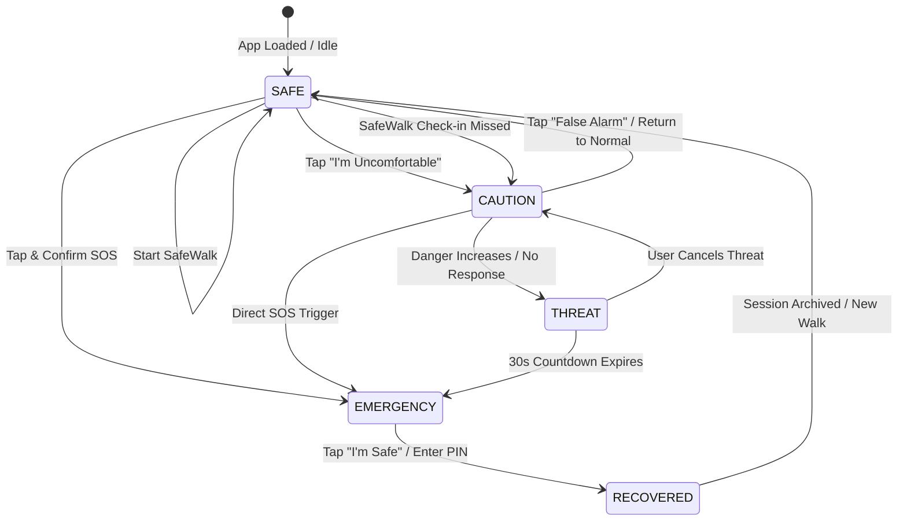

# User Flow & Journey Specification: SAHELI

## Product: SAHELI — Smart Women Safety & Emergency Assistance Platform
**Document:** End-to-End User Experience & Presentation Flow
**Core Motto:** *Safety before the emergency.*

---

## 1. High-Level State Transition Diagram



---

## 2. Primary College Demo Journey (Step-by-Step)

The primary presentation journey follows a student walking back to her hostel at night.

```
┌────────────────────────────────────────────────────────┐
│               1. SafeWalk Initiated                    │
│   User selects destination: "Library to Metro Station"  │
│   Status: [SAFE] (Green)                               │
└──────────────────────────┬─────────────────────────────┘
                           │
                           ▼
┌────────────────────────────────────────────────────────┐
│               2. Journey Becomes Active                │
│   Simulated movement begins; ETA: 12 minutes           │
│   Check-in timer active (every 3 simulated minutes)    │
└──────────────────────────┬─────────────────────────────┘
                           │
                           ▼
┌────────────────────────────────────────────────────────┐
│             3. User Feels Uncomfortable                │
│   Notices a group loitering; taps "I'm Uncomfortable"  │
│   Status: [CAUTION] (Amber)                            │
└──────────────────────────┬─────────────────────────────┘
                           │
                           ▼
┌────────────────────────────────────────────────────────┐
│          4. Assistance & Safe Haven Routing            │
│   System highlights nearest 24/7 Apollo Pharmacy       │
│   Simulated silent ping sent to Guardians              │
│   Option for "Fake Incoming Call"                      │
└──────────────────────────┬─────────────────────────────┘
                           │
                           ▼
┌────────────────────────────────────────────────────────┐
│                5. Situation Escalates                  │
│   Stranger approaches; user taps prominent SOS         │
│   Status: [EMERGENCY] (Pulsing Red Alert)              │
└──────────────────────────┬─────────────────────────────┘
                           │
                           ▼
┌────────────────────────────────────────────────────────┐
│           6. Simulated Emergency Dispatches            │
│   - Mock siren audio toggled                           │
│   - Simulated emergency SMS with GPS sent to 3 contacts│
│   - Simulated Police 112 emergency notification        │
└──────────────────────────┬─────────────────────────────┘
                           │
                           ▼
┌────────────────────────────────────────────────────────┐
│               7. Safe Haven Reached                    │
│   User safely enters pharmacy shop                     │
│   Taps "I'm Safe" button                               │
└──────────────────────────┬─────────────────────────────┘
                           │
                           ▼
┌────────────────────────────────────────────────────────┐
│              8. Recovered & Incident Debrief           │
│   Status: [RECOVERED] (Teal)                           │
│   Reassurance messages sent to Guardians               │
│   Comprehensive Incident Timeline displayed            │
└────────────────────────────────────────────────────────┘
```

---

## 3. Detailed Screen-by-Screen User Flows

### Flow A: Initiating a SafeWalk (Prevention Phase)
1. **Screen:** Safety Dashboard.
2. **Action:** User clicks **"Start SafeWalk"**.
3. **Modal/View:** Select destination (Preset: *Campus Library to Metro Station*, 1.2 km, ETA 14 mins).
4. **Action:** User clicks **"Start Walk"**.
5. **Outcome:**
   - Active walk card mounts on dashboard.
   - Progress bar begins advancing (1% every 2 seconds in demo mode).
   - Check-in countdown initialized.
   - Incident Timeline registers: `"SafeWalk initiated to Metro Station"`.

---

### Flow B: "I'm Uncomfortable" Flow (Assist Phase)
1. **Trigger:** User taps the prominent yellow **"I'm Uncomfortable"** button on the dashboard.
2. **Immediate System Response:**
   - State switches to **`CAUTION`** (warm amber ambient theme).
   - Top status banner states: *"Caution Mode: Stay alert. Guardians alerted silently."*
   - Audio/haptic: Soft reassurance chime.
3. **Assist Panel Displays 3 Immediate Tools:**
   - **Tool 1: Find Safe Place** -> Highlights nearest open haven (e.g. *Apollo Pharmacy, 180m* with 1-tap route preview).
   - **Tool 2: Fake Call Simulator** -> User taps "Fake Call" -> Phone screen displays realistic incoming call from *"Papa"* with ringtone audio; user can "Accept" to hear automated speech simulation.
   - **Tool 3: Silent Guardian Standby** -> Shows confirmation: *"3 Guardians notified to keep phone nearby"*.
4. **Resolution Options:**
   - If feeling better: User taps **"All Good Now"** -> Returns to `SAFE`.
   - If danger escalates: User taps **"Escalate to SOS"** or timer triggers **`THREAT`**.

---

### Flow C: SOS / Emergency Response Flow (Escalate Phase)
1. **Trigger:** User taps **"SOS EMERGENCY"** button (or 3-second quick-hold).
2. **Confirmation Safeguard:** 3-second rapid abort countdown modal appears (*"Cancelling in 3... 2... 1..."* to prevent false triggers).
3. **Full Emergency Activation:**
   - State switches to **`EMERGENCY`** (high-visibility pulsing red screen).
   - Simulated loud siren sound button available (uses Web Audio API with simple mute toggle for class presentations).
   - **Simulated Dispatch Broadcast:**
     - Guardian 1 (*Maa*): `[SIMULATED SMS SENT: SOS! My location is 28.6139° N, 77.2090° E]`
     - Guardian 2 (*Aarav*): `[SIMULATED SMS SENT: SOS! Near Apollo Pharmacy]`
     - Police (*112*): `[SIMULATED DISPATCH CREATED]`
   - Live simulated audio recording indicator (visual mockup: *"Microphone capturing incident proof"*).

---

### Flow D: "I'm Safe" & Incident Debrief Flow (Recover Phase)
1. **Trigger:** Danger is averted; user taps green **"I'm Safe"** button.
2. **Verification:** Short confirmation prompt: *"Confirm you are in a safe location."*
3. **State Change:** State changes to **`RECOVERED`** (calm teal theme).
4. **Automated Actions:**
   - Simulated all-clear broadcast: *"Simulated SMS sent to guardians: I am safe now."*
   - Siren instantly muted.
   - SafeWalk session finalized.
5. **Debrief Display:** Full **Incident Timeline** rendered with copy/export simulation option for college evaluation.

---

## 4. College Presentation Walkthrough Script (2–3 Minutes)

| Time | Presenter Action | System Response | What to Say to Evaluators |
|---|---|---|---|
| **0:00 - 0:30** | Show Landing Page, tap "Launch Demo". | Opens Dashboard in `SAFE` state. | *"Most apps wait for violence. SAHELI protects before the emergency. Here is our central safety dashboard."* |
| **0:30 - 1:00** | Click "Start SafeWalk" -> "Campus to Metro". | Walk progress ticks up; check-in active. | *"Our user starts SafeWalk. It actively tracks progress and schedules check-in alerts."* |
| **1:00 - 1:40** | Click "I'm Uncomfortable". | Dashboard shifts to `CAUTION` (amber). Safe havens appear. | *"She feels uneasy. Instead of waiting for an assault, she taps 'I'm Uncomfortable'. Notice how SAHELI immediately suggests nearby 24/7 safe shelters and offers a fake call."* |
| **1:40 - 2:10** | Tap "SOS Emergency" -> let 3s count down. | Flashing red screen, simulated siren, emergency dispatch logs. | *"The threat escalates. One tap triggers simulated distress broadcasts to her guardian network and 112 services."* |
| **2:10 - 2:45** | Tap "I'm Safe" -> view Incident Timeline. | Screen turns calm teal (`RECOVERED`). Incident Timeline displays full audit. | *"She enters the pharmacy and taps 'I'm Safe'. SAHELI reassures her guardians and logs the entire incident for forensic safety."* |
